# 🛡️ National Cyber Crime Reporting Portal — Prototype

A realistic, full-stack **prototype** of a national cyber crime reporting portal: citizens register
and track cyber crime complaints with evidence uploads, and officers triage and maintain the
complaint register from a secure console.

> **⚠️ Demonstration project.** This is **not** affiliated with, endorsed by, or operated by the
> Government of India or any police authority. Every record is fictitious. For real cyber crime use
> [cybercrime.gov.in](https://cybercrime.gov.in) or call **1930**.

---

## 📸 Screenshots

| Citizen website | |
|---|---|
| **Home — government-style masthead, advisory ticker, live stats** | 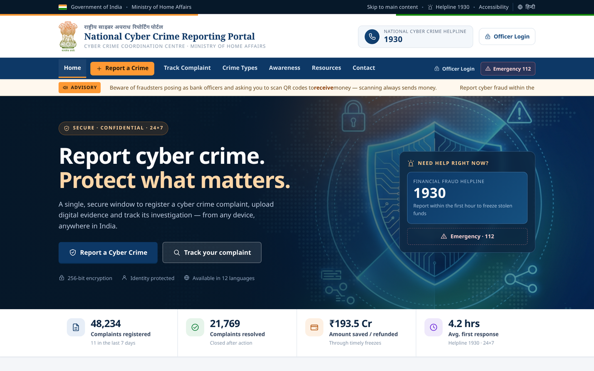 |
| **4-step complaint wizard** | 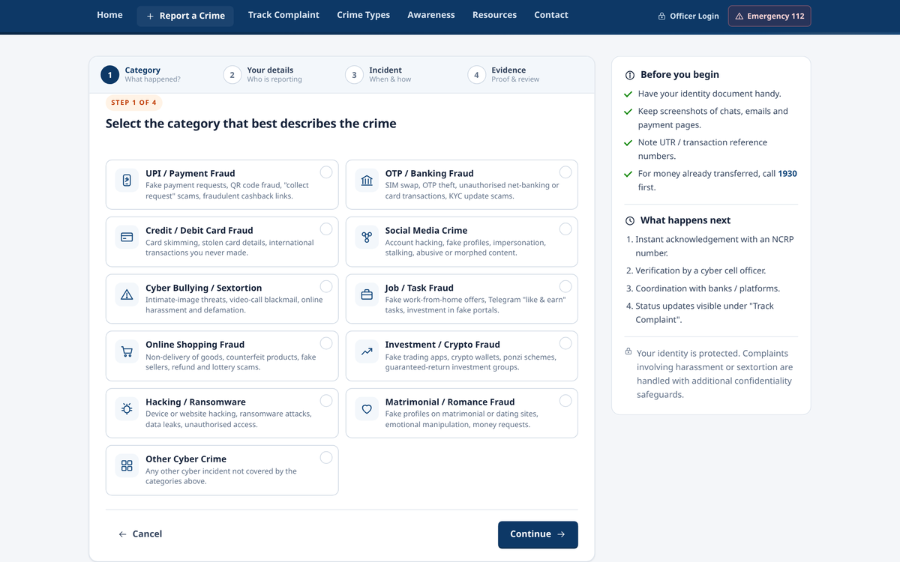 |
| **Evidence upload with staged files & captcha** | 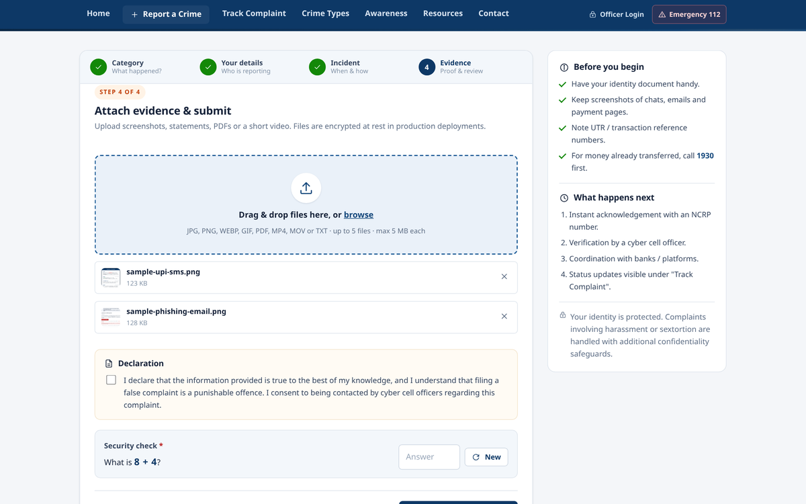 |
| **Track a complaint — stepper, timeline, evidence** | 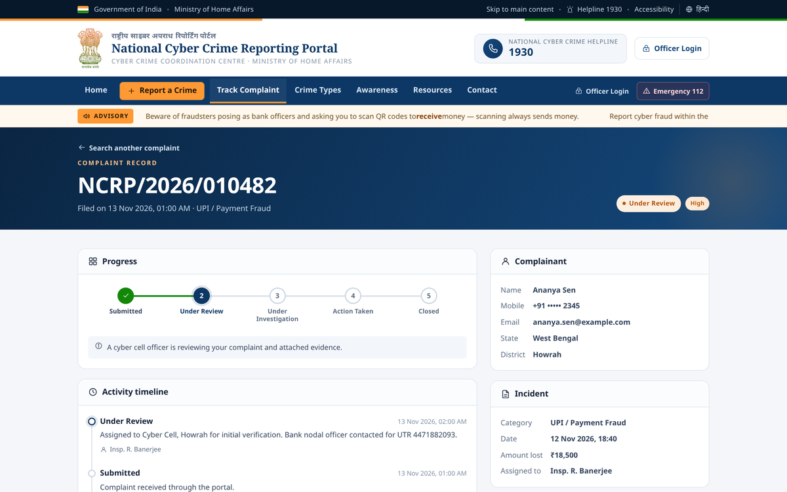 |
| **Crime-type guide** | 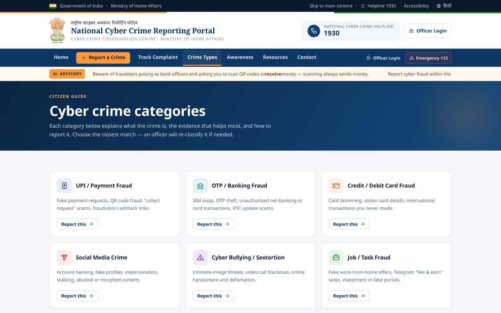 |
| **Awareness advisories** | 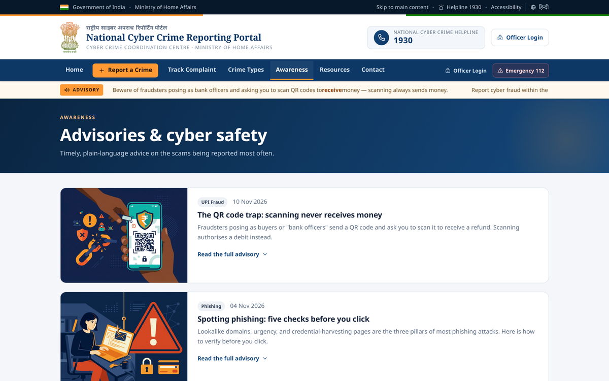 |

| Officer console | |
|---|---|
| **Dashboard — KPIs, sparkline, donut, category bars, alert queue** | 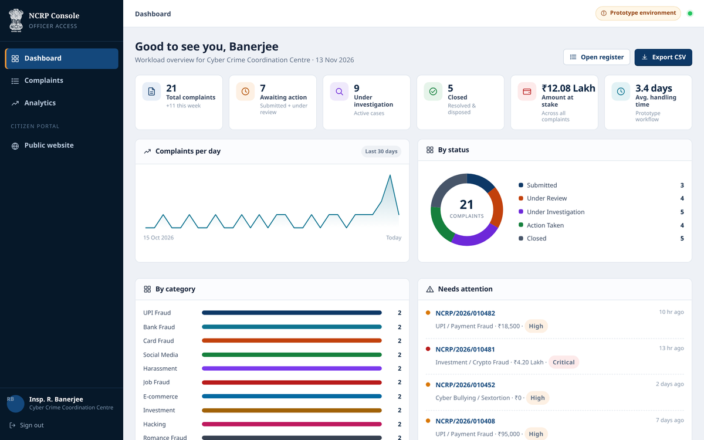 |
| **Complaint register — search, filters, pagination** | 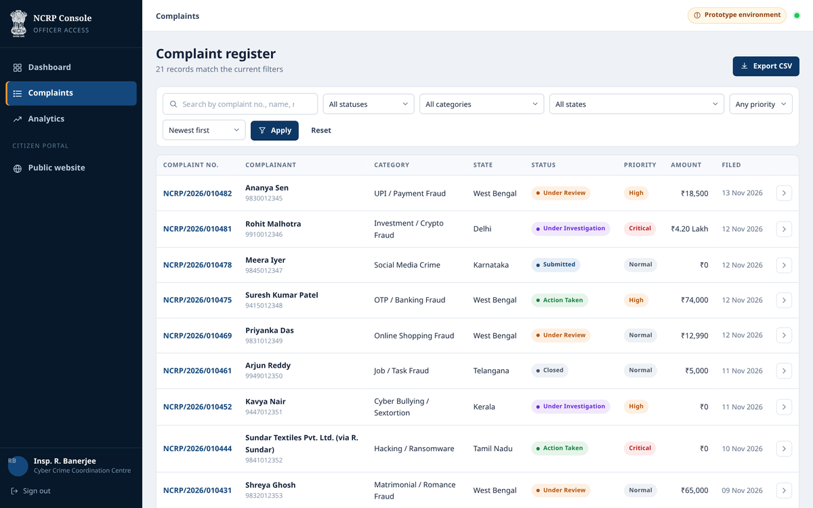 |
| **Case detail — records, evidence gallery, timeline, update form** | 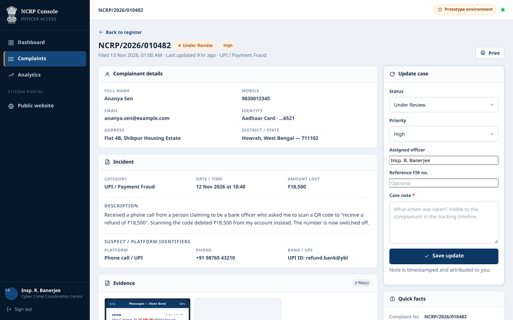 |
| **Analytics** | 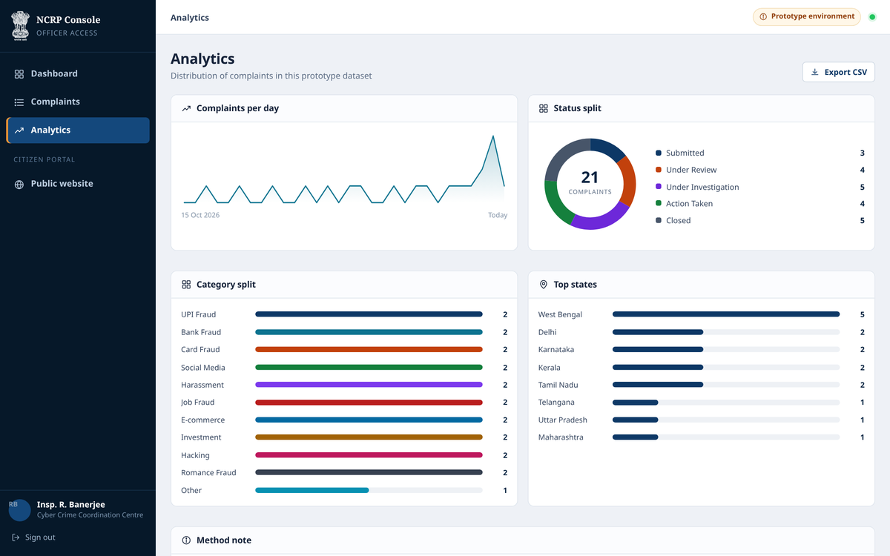 |

<p align="center">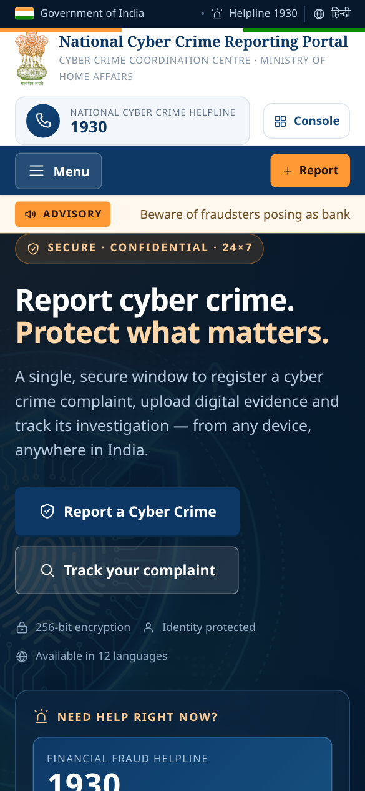</p>

---

## ✨ What's inside

### Citizen-facing website
| Page | What it does |
|---|---|
| **Home** | Government-style masthead, tricolour strips, live statistics band, advisory ticker, service cards, recent (fictitious) records |
| **Report a Crime** | 4-step wizard — category → personal details → incident → evidence & declaration, with arithmetic captcha, drag-and-drop uploads, inline validation, and instant NCRP acknowledgement number |
| **Track Complaint** | Complaint number + registered mobile verification → status stepper, officer timeline, evidence viewer |
| **Crime Types** | Guide to 11 crime categories with evidence checklists |
| **Awareness** | Advisories with illustrations, do/don't safety rules |
| **Resources** | Downloadable guides/checklists + external official links |
| **Helpline** | 1930 / 112 / 1091 / 1098 directory and calling checklist |
| **Static pages** | FAQ, About, Privacy, Terms, Accessibility (all cross-linked in the footer) |

### Officer console (`/admin`)
- **Dashboard** — KPIs, 30-day sparkline, status donut, category bars, "needs attention" queue, latest complaints
- **Complaint register** — full-text search + filters (status, category, state, priority, sort) and pagination
- **Case detail** — complainant & incident record, suspect identifiers, evidence gallery with download, timeline, and an **update case** form (status, priority, assigned officer, FIR no., case note)
- **Analytics** — distribution by status, category, and state
- **CSV export** of the register
- Session auth with bcrypt hashes, signed HttpOnly cookie, login rate limiting

### Engineering
- Server-rendered HTML (no client framework) with a hand-written design system (~1,600 lines of CSS)
- JSON file store with atomic writes and automatic seeding on first boot
- Upload validation (type + size), CSP, `X-Content-Type-Options`, `Referrer-Policy`, rate limiting
- Responsive down to 360 px, keyboard-operable wizard, ARIA labels, skip link, print styles
- Zero build step — `npm install && npm start`

---

## 🚀 Run locally

```bash
git clone <your-repo-url> ncrp-prototype
cd ncrp-prototype
npm install
npm start
# → http://localhost:3000
```

Optional configuration (see `.env.example`):

| Variable | Default | Purpose |
|---|---|---|
| `PORT` | `3000` | HTTP port |
| `SESSION_SECRET` | dev fallback | Signs the officer session cookie — **change in production** |
| `ADMIN_PASSWORD` | `Admin@1930` | Password for the seeded `admin` account |
| `COOKIE_SECURE` | `false` | Set `true` behind HTTPS |
| `DATA_DIR` | `./data` | JSON store location |
| `UPLOAD_DIR` | `./uploads` | Evidence file storage |

**Demo logins**

| Role | Username | Password |
|---|---|---|
| Administrator | `admin` | `Admin@1930` |
| Officer | `officer` | `Officer@1930` |

**Sample complaint for the Track page:** `NCRP/2026/010482` with mobile `9830012345`
(the Track page has a one-click "fill demo" link).

Reset all data to the seeded state:

```bash
npm run seed
```

---

## ☁️ Deploy on Render

> 🇮🇳 **Hinglish step-by-step guide:** [`docs/DEPLOY-GUIDE-HINGLISH.md`](docs/DEPLOY-GUIDE-HINGLISH.md) —
> GitHub upload se lekar Render pe live hone tak, screenshots-style instructions aur
> common errors ka fix.


### Option A — Blueprint (fastest)

1. Push this folder to GitHub.
2. In Render: **New → Blueprint**, pick your repo. Render reads `render.yaml`.
3. When prompted, type your own `ADMIN_PASSWORD`.
4. Deploy. Your site is live at `https://<service-name>.onrender.com`.

`render.yaml` is configured for the **free plan**: `npm install` → `npm start`, health check on
`/healthz`, `SESSION_SECRET` auto-generated, `COOKIE_SECURE=true`.

> **Persistence:** the free plan has no disk, so complaints/uploads reset on every restart or
> redeploy (the site re-seeds its sample data and keeps working). For durable storage, switch
> to `plan: starter` and uncomment the DISK block at the bottom of `render.yaml` — or add a
> disk manually with `DATA_DIR=/var/data` and `UPLOAD_DIR=/var/data/uploads`.

### Option B — Manual web service

1. **New → Web Service** → connect the repo.
2. Runtime **Node**, build `npm install`, start `npm start`.
3. Add env vars: `SESSION_SECRET` (random), `ADMIN_PASSWORD`, `COOKIE_SECURE=true`.
4. (Optional) **Disks → Add Disk**, mount `/var/data`, then set `DATA_DIR=/var/data`
   and `UPLOAD_DIR=/var/data/uploads`.

### Deploying to GitHub first

```bash
git init
git add .
git commit -m "NCRP prototype: citizen portal + officer console"
git branch -M main
git remote add origin https://github.com/<you>/<repo>.git
git push -u origin main
```

`.gitignore` already excludes `node_modules/`, `data/`, and `uploads/` — the store re-seeds
automatically on the server's first boot.

---

## 🗺️ Routes

```
GET  /                       Home
GET  /report                 Complaint wizard
POST /report                 Create complaint (multipart, max 5 files × 5 MB)
GET  /success/:id            Acknowledgement with NCRP number
GET  /track                  Tracking form
POST /track                  Track by complaint number + mobile
GET  /crime-types            Category guide
GET  /awareness              Advisories
GET  /resources              Downloads
GET  /contact                Contact page
GET  /helpline               Helpline directory
GET  /page/:slug             faq | privacy | terms | accessibility | about
GET  /downloads/:name        complaint-guide | evidence-checklist | cyber-safety-checklist
GET  /healthz                Health check (used by Render)

GET  /admin/login            Officer sign-in
POST /admin/login
GET  /admin                  Dashboard
GET  /admin/complaints       Register (search + filters + pagination)
GET  /admin/complaints/:id   Case detail
POST /admin/complaints/:id/status   Update status / note
GET  /admin/analytics        Charts
GET  /admin/export.csv       CSV export
GET  /admin/logout
```

---

## 📁 Project layout

```
cybercrime-portal/
├── src/
│   ├── server.js              Express app, headers, session middleware
│   ├── config.js              Categories, statuses, states, limits
│   ├── db.js                  JSON store, seeding, queries, stats
│   ├── security.js            Signed cookies, captcha, rate limit, bcrypt
│   ├── util.js                Formatting & escaping helpers
│   ├── seed-cli.js            `npm run seed`
│   ├── views/
│   │   ├── layout.js          Header/footer/nav, icon system, badges
│   │   ├── public.js          Home, crime types, helpline
│   │   ├── report.js          Complaint wizard
│   │   ├── track.js           Tracking + acknowledgement
│   │   ├── content.js         Awareness, resources, contact, static pages
│   │   └── admin.js           Login, dashboard, register, case detail
│   └── routes/
│       ├── public.routes.js   Public routes + upload handling
│       └── admin.routes.js    Auth-guarded console routes
├── public/
│   ├── css/styles.css         Design system (single stylesheet)
│   ├── js/                    main · report · track · admin · contact
│   ├── img/                   Emblem, hero, awareness art, sample evidence
│   └── downloads/             Text checklists served as attachments
├── data/                      JSON store (git-ignored, auto-seeded)
├── uploads/evidence/          Uploaded files (git-ignored)
├── docs/                      Screenshots + deployment notes
├── render.yaml                Render Blueprint
└── .env.example
```

---

## 🔐 Security notes for a prototype

Implemented: bcrypt password hashing, HMAC-signed session cookie (HttpOnly, SameSite=Lax,
optional Secure), login and lookup rate limiting, allow-listed upload MIME types and size caps,
HTML escaping in every view, CSP without inline scripts, and `nosniff` / frame / referrer headers.

Before running this as anything more than a demo you would also need: a real database, virus
scanning and private object storage for evidence, CSRF tokens, per-user authorisation on the
tracking endpoint, audit logging, encryption at rest, and a legal/privacy review. Evidence files
are served from a random unguessable filename — treat that as obscurity, not access control.

## ⚖️ A note on the emblem & naming

The portal's name, layout, helpline numbers and the State Emblem of India are used here to
demonstrate a realistic government-style interface. **Publish this as a clearly-labelled
prototype or portfolio piece**, keep the disclaimer footer visible, and consider replacing the
emblem with your own shield artwork before sharing widely — use of the national emblem is
regulated by the State Emblem of India (Prohibition of Improper Use) Act, 2005.

## 📄 License

MIT — see `LICENSE`.
